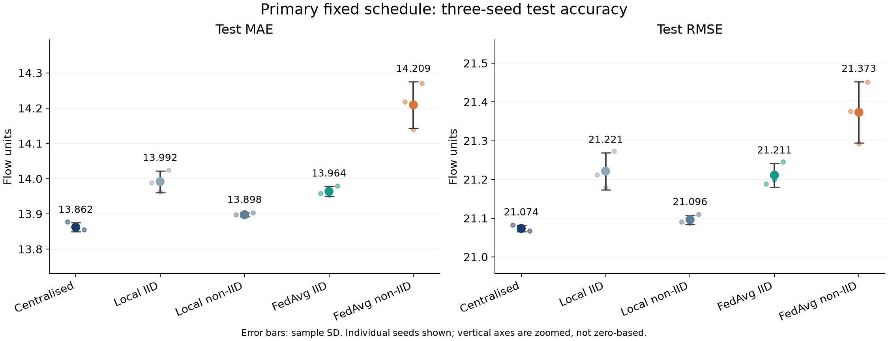
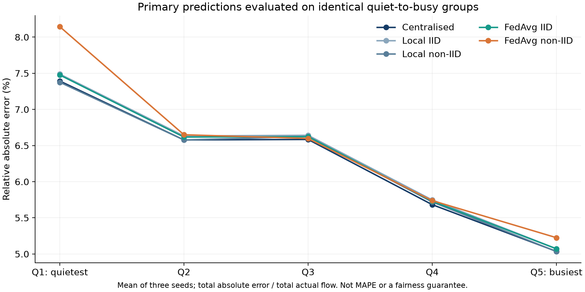
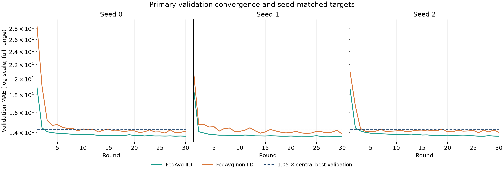
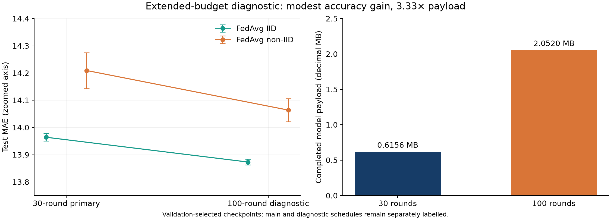
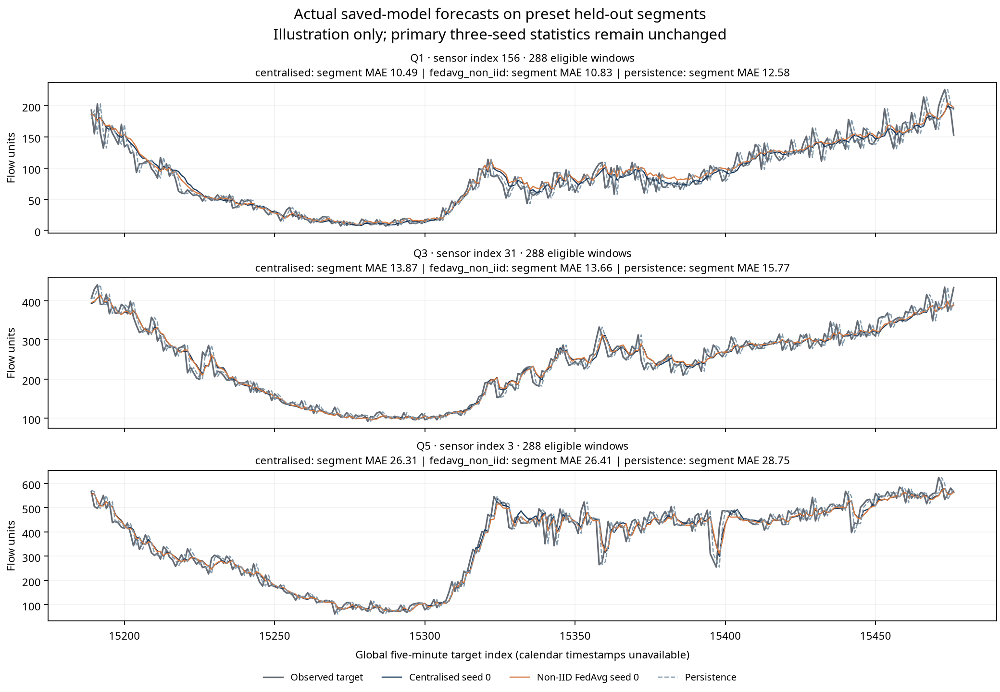
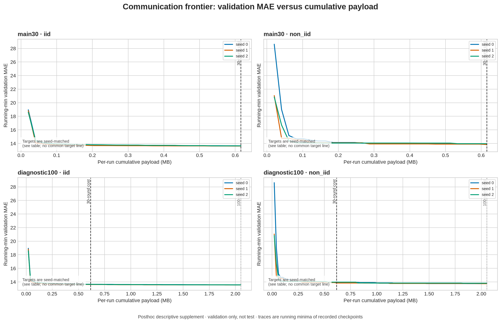

# Final evaluation report

**A3-PS003-TC520 · Chauraha Sync · AIORI-3 / Smart Cities**  
Aryan Jha (team lead), Apeksha Benneshiroor; the package identifies Dr. Monika Puttaramaiah as faculty mentor, but this report does not assert mentor review or attendance. BMS College of Engineering. Prepared October 19, 2026.

## Executive conclusion

The PS-003 scientific work is complete: a compact NumPy forecaster and FedAvg simulator, five virtual clients, chronological splits, IID/non-IID comparisons, three seeds, test errors, client diagnostics, validation histories and accounted payload bytes. This is an evaluation contribution, not a novel federated algorithm or a deployed traffic-control service.

Centralised training has the lowest primary mean test MAE: **13.862 ± 0.013**. IID FedAvg is **13.964 ± 0.014**, or **0.73% higher** than centralised; non-IID FedAvg is **14.209 ± 0.066**, or **2.50% higher**. All 15 learned runs beat persistence on both MAE and RMSE. Non-IID FedAvg takes longer to reach a seed-matched validation target and has a larger relative-error disparity on identical quiet-to-busy evaluation groups. H4 is refuted: its quietest group has **10.42% worse MAE** than matched local-only training.

The separate 100-round diagnostic slightly reduces MAE while spending **3.33 times** the model payload. It does not replace the frozen 30-round primary comparison. California benchmark results do not establish Bengaluru validity, formal privacy or cellular-bandwidth savings.

Tables below are rounded for reading. Full-precision seed values, all per-client rows and histories remain in the raw JSONs and generated `reports/tables/` CSV/JSON files. Sample SD uses `ddof=1`; no significance or equivalence test is claimed.

## 1. Scope, data and protocol

PEMS08 has **17,856 time steps × 170 sensors × 3 channels**. Channel 0 is flow, sampled every five minutes. Dataset SHA-256 is `e1d03ce74e9fb79149e6e7c37c680214822c4a285baa2f42278cacabcd25c075`. The package is obtained from the ASTGNN repository; Caltrans is the underlying measurement-source context. Dataset redistribution rights were not established, so the raw file is excluded from the submission.

The split is chronological: train `[0,12499)`, validation `[12499,15177)`, test `[15177,17856)`. Twelve preceding flows predict the next flow. Windows never cross split boundaries. Mean and standard deviation use valid, nonzero training values only. Features are 12 scaled lags plus sine/cosine of the **global target index modulo 288**; no calendar timestamps or day-of-week are used.

There are **0 NaNs, 0 infinities and 10,560 exact-zero flow entries**, or **0.348%**. Treating every exact zero as a source-missing marker is a modelling assumption, not a proven dataset-wide fact. A sensor-time window is removed if its 12 inputs or target contain zero. A zero at one sensor does not discard other sensors' windows at that time. Eligible counts are **2,098,136 train; 448,263 validation; 448,533 test**. A forward-fill sensitivity run is not part of this release.

Five clients each own 34 sensors. IID-style assignments use a seed-dependent random sensor permutation; this is a random-membership control, not proof of mathematical IID data. Non-IID groups are fixed quiet-to-busy bands ordered by valid training mean. Initialisation and batch ordering vary across seeds 0, 1 and 2; non-IID membership does not.

Primary mean pairwise Wasserstein-1 distance compares clients' distributions of **per-sensor valid training mean flow**. IID-style values for seeds 0/1/2 are **28.407 / 30.085 / 30.793**, versus **127.867** for non-IID. Pooled-observation W1 is a separate secondary statistic and is not mixed into this comparison.

## 2. Model, training and checkpoint selection

The forecaster is **14 → 32 ReLU → 1**, with **513 float32 parameters**. Training minimises scaled-flow MSE using Adam, learning rate **0.001**, batch size **1,024**. Final errors are computed after inverse scaling in original flow units.

Centralised training pools eligible training windows into one model. Local-only training uses five independent client models and is run under **both** memberships. FedAvg broadcasts one global model to all five clients, trains each for one local epoch, and averages parameters with weights proportional to eligible local training-window counts. Local Adam state resets each FedAvg round and is never transmitted. In centralised/local-only training, Adam state persists across epochs.

Primary schedules are **30 centralised/local epochs** and **30 FedAvg rounds × one local epoch**. These schedules give comparable nominal sample passes, not identical optimisation steps, parameter trajectories, wall-clock parallelism or deployment costs. The simulator executes local work in one process; clients are virtual.

Every global checkpoint minimises validation MAE. Each local-only model selects its own client-validation minimum. The selected predictor(s) are then evaluated once on the common test windows. No test-driven checkpoint selection is used. Original selected epochs/rounds and their validation values remain in each raw JSON; the strengthened checker validates argmin identity **and** its reported value, including all five local clients.

## 3. Primary test accuracy

| Arrangement | Test MAE, mean ± sample SD | Test RMSE, mean ± sample SD | MAE reduction vs persistence |
| --- | ---: | ---: | ---: |
| Centralised | 13.862 ± 0.013 | 21.074 ± 0.008 | 13.78% |
| Local IID | 13.992 ± 0.031 | 21.221 ± 0.048 | 12.97% |
| Local non-IID | 13.898 ± 0.005 | 21.096 ± 0.012 | 13.56% |
| FedAvg IID | 13.964 ± 0.014 | 21.211 ± 0.031 | 13.15% |
| FedAvg non-IID | 14.209 ± 0.066 | 21.373 ± 0.079 | 11.62% |

Persistence has **MAE 16.0775305273, RMSE 24.4507521915**. The per-sensor daily-cycle baseline has **MAE 34.7763271710, RMSE 51.0779810015**. Both score the same 448,533 test windows. Persistence is a fixed last-observation predictor; the daily-cycle baseline fits a separate training-only mean for each sensor and global modulo-288 slot. It is neither sensor-pooled nor timestamp-aware.

FedAvg IID exceeds centralised mean MAE by **0.101594**, while FedAvg non-IID exceeds it by **0.346857**. Non-IID exceeds IID FedAvg by **0.245263**. For the matched IID comparison, FedAvg minus Local IID is **-0.030604554687744923 / -0.008634277335549001 / -0.043784769237481314** for seeds 0/1/2, mean **-0.02767453**; the lower value occurs in every seed, but it is small and is not a statistical tie or equivalence claim. For the matched non-IID comparison, FedAvg minus Local non-IID averages **+0.3114613 MAE** and is worse in every seed. The evidence supports a modest heterogeneity-related penalty under this protocol, not a general theorem that centralised or federated training always wins.

The corrected daily-cycle baseline, complete-case filtering, matched local partitions and correct test-versus-validation fields supersede the preliminary Level 1 presentation. Old values must not be reused as final results.

### Level 1 superseded explanation

- The pooled daily-cycle baseline (about **89.7 MAE**) was replaced by the per-sensor baseline (**34.776 MAE**).
- Exact-zero handling and the preprocessing protocol also changed, so this is not a clean single-fix ablation.
- Earlier FedAvg validation metrics were mislabeled as test metrics; the current labels are corrected.
- Leakage handling, preprocessing and checkpoint provenance are now consistent in the current result package.
- The original run has no Git commit; preserve that provenance and do not retroactively insert one.

The core optimizer is fixed; no isolated optimizer change is claimed as the explanation for these corrections.

## 4. Client disparity on identical groups

Relative absolute error is `sum(abs(prediction − actual)) / sum(actual)`. It is **not MAPE** and does not divide by each individual target. The headline disparity is the maximum minus minimum client relative error. Expressed below in percentage points, it compares predictions on the **same canonical quiet-to-busy sensor groups** for every method. Comparing random-client gaps with traffic-band gaps would confound performance and group membership.

| Arrangement | Canonical relative-error gap, mean ± sample SD |
| --- | ---: |
| Centralised | 2.356 ± 0.026 pp |
| Local IID | 2.415 ± 0.015 pp |
| Local non-IID | 2.342 ± 0.030 pp |
| FedAvg IID | 2.404 ± 0.040 pp |
| FedAvg non-IID | 2.919 ± 0.062 pp |

The paired gap increase for non-IID versus IID FedAvg is **0.514573 pp**. Relative to centralised, the corresponding increase is **0.562301 pp**. These are gap changes, not changes in overall relative absolute error. Non-IID FedAvg's overall relative error exceeds centralised by **0.148601 pp**.

The following canonical group errors are three-seed means, shown as percentages:

| Arrangement | Q1 quietest | Q2 | Q3 | Q4 | Q5 busiest |
| --- | ---: | ---: | ---: | ---: | ---: |
| Centralised | 7.393% | 6.578% | 6.585% | 5.683% | 5.037% |
| Local IID | 7.489% | 6.633% | 6.642% | 5.748% | 5.073% |
| Local non-IID | 7.376% | 6.577% | 6.626% | 5.720% | 5.034% |
| FedAvg IID | 7.476% | 6.618% | 6.624% | 5.730% | 5.072% |
| FedAvg non-IID | 8.145% | 6.650% | 6.599% | 5.739% | 5.226% |

For Q1, non-IID FedAvg MAE is **7.983463**, versus **7.229963** for matched local non-IID. Its mean difference is **+0.753500**, or **10.42% worse** using the ratio of the two means. The per-seed MAE differences are **+0.808062 / +0.656473 / +0.795965**. RMSE is also worse by **0.691861** on average. H4's predicted direction is therefore refuted on every main seed.

Lower absolute MAE for quiet traffic does not mean lower proportional burden. The random-membership comparison is descriptive; the frozen document's “noise floor” phrase is not a statistical noise estimate or a fairness guarantee. Counts vary after filtering: seed-0 canonical test-group sizes are **86,252 / 90,550 / 90,559 / 90,494 / 90,678**. All client MAE/RMSE/relative-error/count rows are supplied in `all_clients.csv` and `summary.json`.

## 5. Validation convergence and checkpoints

For a descriptive speed comparison, define a seed-matched target of **1.05 × that seed's best centralised validation MAE**. It is not a test-error target or an operational stopping rule. The target values are **14.247689 / 14.223784 / 14.249224** for seeds 0/1/2.

| Federated condition | First target round, seeds 0/1/2 | Selected main round, seeds 0/1/2 | Selected diagnostic round, seeds 0/1/2 |
| --- | --- | --- | --- |
| IID | 3 / 2 / 3 | 30 / 29 / 30 | 92 / 97 / 97 |
| Non-IID | 9 / 6 / 4 | 26 / 30 / 26 | 96 / 98 / 89 |

Non-IID reaches the target later on all three paired seeds. Its main test-MAE sample SD is **0.065827**, versus IID's **0.013982**. “Converged” here means reaching a defined empirical target; it does not prove optimisation convergence or that 30 rounds exhaust improvement.

Actual completed-run communication includes every scheduled round. Retrospective cost to a best checkpoint or target is not the cost the completed experiment actually incurred. Target-hit payloads are **61,560 / 41,040 / 61,560 B** for IID and **184,680 / 123,120 / 82,080 B** for non-IID. Exact histories and target/checkpoint rows are in `validation_histories.csv` and `rounds_to_target.csv`.

## 6. Separate 100-round diagnostic

| Diagnostic condition | Test MAE, mean ± sample SD | Test RMSE, mean ± sample SD | Canonical relative-error gap |
| --- | ---: | ---: | ---: |
| FedAvg IID, 100 rounds | 13.873 ± 0.010 | 21.087 ± 0.013 | 2.396 pp |
| FedAvg non-IID, 100 rounds | 14.064 ± 0.043 | 21.218 ± 0.034 | 2.796 pp |

All six first-30-round prefixes exactly match the primary histories. From 30 to 100 rounds, paired mean test MAE falls by **0.090973** for IID and **0.145459** for non-IID; reductions relative to main means are **0.65%** and **1.02%**. Validation also improves. The main conclusions persist, including the quietest group's disadvantage versus local-only: its diagnostic MAE remains **7.68% worse**. This is evidence only over the observed range through round 100, not proof of a plateau or eventual convergence.

The historical diagnostic audit record checked files, metadata, histories, metric identities, checkpoint selection, costs and exact prefixes, but did **not** reconstruct round-31-to-100 predictions in a separate fresh implementation. Its conclusions are artifact-verified, not a claim that all six extended runs were freshly retrained by a human or accredited auditor. No new tuning or optional algorithm is introduced.

## 7. Communication accounting and break-even

Each model has **513 × 4 = 2,052 float32 bytes**. Five clients each download and upload one model per round, giving **20,520 B/round**. Counts exclude optimiser state, protocol headers, encryption, retries, transport framing and deployment operations. They are simulator tensor accounting, not measured cellular traffic.

A completed 30-round run costs **615,600 B**; a completed 100-round run costs **2,052,000 B**, an increase of **1,436,400 B** and multiplier **3.333333**. The primary one-time training-flow reference is **12,499 × 170 × 4 = 8,499,320 B**. Thirty-round payload is **92.76% lower** than that specific reference; the reference is **13.81 times** larger. This does not compare against a compressed stream, live cameras or an end-to-end deployment.

The analytical crossing is **8,499,320 / 20,520 = 414.196881 rounds**. Whole-round payload remains below the reference through round 414 and exceeds it at round **415**. This is a labelled byte-reference crossing, not a production economic break-even.

Centralised/local-only files report **zero federated model-exchange bytes**. That does not mean zero centralised raw-data upload, memory, computation, networking or system cost. FedAvg is therefore a conditional systems choice: it can be relevant when raw data must remain at clients or one shared model is required, but this study gives no privacy guarantee. On accuracy alone, current non-IID history favours local-only by **0.3114613 MAE on average**, worse for FedAvg in every seed. No scarcity or low-resource benefit was run or proven.

## 8. Hypotheses

**H1 — supported descriptively.** IID FedAvg's overall MAE is **0.73% higher** than centralised; non-IID FedAvg has a larger canonical relative-error gap. No significance or equivalence test is claimed.

**H2 — supported descriptively on all three paired seeds.** Non-IID has larger test-MAE dispersion and takes 9/6/4 rounds versus IID's 3/2/3 to reach the validation target. Three seeds do not establish general statistical significance.

**H3 — supported.** Every learned main run beats persistence in both MAE and RMSE under the common complete-case protocol.

**H4 — refuted.** The quietest group's non-IID FedAvg predictor is worse than its matched local-only predictor on all main seeds; the diagnostic does not reverse this finding. Negative results are retained rather than forcing a FedAvg-success story.

The supplied decisions identify hypotheses as frozen before training. Their document is preserved unchanged. Missing historical Git provenance prevents independently proving a pre-run commit's date; a new upload commit must not be retroactively represented as that commit.

## 9. Audit evidence, limitations and safe claims

The historical records `reports/INDEPENDENT_MAIN_AUDIT.md` and `reports/INDEPENDENT_DIAGNOSTIC_AUDIT.md` are retained for provenance but should be read as **AI-assisted audit records**, not independent human, professional or accredited certification. The main record reports **793 checks**; a separate-process numerical reproduction reran two fixed seed-0 cases (centralised and non-IID FedAvg) to numerical tolerance. The diagnostic record reports **1,408 checks** with exact prefixes for all six runs. Release packaging strengthens the checker and adds replay/demo safeguards without modifying core learning code, configs or original result bytes. Historical audit reports and source/result hashes are included; new package validation is recorded separately.

The central limitations are geography, one public dataset, one-step forecasting, complete-case zero assumptions, virtual clients, shared training-derived scaler, three fixed seeds, differing optimisation arrangements and omitted network overhead. Local-only uses **five independent 513-parameter models, 2,565 parameters in total**, whereas centralised/FedAvg use one shared 513-parameter model. This is an arrangement comparison, not an equal-total-capacity ablation. No formal privacy, timestamp-aware calendar modelling, deployment readiness or city-wide impact is demonstrated. Sensitivity analyses and new models are not required missing PS-003 deliverables.

Safe wording is: **“On the AI-assisted, artifact-checked PEMS08 complete-case protocol, IID FedAvg has a small measured mean-MAE gap from centralised training, while non-IID groups have slower target attainment and greater proportional client disparity; extra rounds modestly improve accuracy at a larger accounted payload cost.”** Unsafe wording is “FedAvg beats centralised,” “privacy guaranteed,” “Bengaluru validated,” “cellular bandwidth measured,” or “fairness solved.”

## 10. Submission and references

Reproduction commands are in `docs/REPRODUCE.md`; mentor demonstration and pseudocode are in `docs/MENTOR_DEMO_AND_PSEUDOCODE.md`. Raw results remain authoritative. Scientific completion does not certify mentoring attendance, prototype demonstration to the mentor, repository permissions or final upload. Those external obligations are explicitly tracked in the requirement check and honest work log.

The source set is the [supplied PS-003 brief](../docs/PS-003_official.pdf), [official AIORI guideline](https://portal.aiori.in/aiori-3/hackathon-guideline/), [McMahan et al. FedAvg paper](https://proceedings.mlr.press/v54/mcmahan17a.html), [ASTGNN benchmark package](https://github.com/guoshnBJTU/ASTGNN), and [Caltrans PeMS source](https://dot.ca.gov/programs/traffic-operations/mpr/pems-source). No paper's unrelated performance percentage is transferred into this study.

**Contacts:** aryanjha.ad26@bmsce.ac.in · apekshabenneshiroor.ec26@bmsce.ac.in · monika.mel@bmsce.ac.in.

## Evidence figures

The charts below are generated from the preserved JSONs by `src/summarize_results.py`. Error bars are sample SD, and zoomed/log axes are explicitly labelled.

## Enhanced demonstration and descriptive frontier — October 19

The enhanced package passes **55 tests**. All **41 preserved original entries** remain byte-identical. Its two exported checkpoints are reproductions of fixed seed-0 primary runs, not new conditions or replacements for the 15-run matrix. Centralised selects epoch 29 and non-IID FedAvg selects round 26. Complete histories, selected checkpoints, final test blocks and costs reproduce the original files within tolerance; maximum absolute floating differences are 3.2867397692371014e-10 and 5.547988735088438e-10. The saved parameter arrays round-trip bit-exactly in float32.

`src/inference.py` now executes actual forward inference from those weights without retraining. The [demonstration guide](../docs/SAVED_MODEL_DEMO.md) distinguishes this from the existing result replay and short smoke learning run. JSON checkpoint file size is not the 2,052-byte float32 exchange payload; this distinction is explicitly documented.

The held-out illustration below uses training-selected upper-median sensors from canonical Q1/Q3/Q5 (indices 156/31/3) and the first 288 eligible target-index slots starting at 15189. No examples were selected by test performance. Segment errors are illustrative seed-0 values, not the report's full-test three-seed estimates. The main findings—including H4's refutation—are unchanged.

The separately labelled [posthoc validation-payload frontier](VALIDATION_PAYLOAD_FRONTIER.md) derives first recorded target crossings from the existing histories, with targets set at 1%, 2%, 5% and 10% above each seed's best centralised validation MAE. Unreached targets are censored, not zero-cost successes. IID reaches the 2% target at rounds 8/5/9. Non-IID does not reach it within 30 rounds, but reaches it at diagnostic rounds 57/50/46. It still does not reach the 1% target within 100 rounds. These are validation-only retrospective findings, not test-by-round curves, a preregistered hypothesis or an operational stopping rule.

### H1 wording and seed variability

H1's original word “similar” has no prospectively fixed numerical equivalence margin. Any support for it is descriptive closeness under this benchmark, not a statistical equivalence result. The observed centralised and IID FedAvg means are reported directly; the later 1%/2%/5%/10% validation-frontier thresholds must not be retroactively substituted into H1 or presented as its original success rule.

Non-IID client membership is fixed across seeds, so its sample SD reflects changes in initialisation and training/batch randomness, not uncertainty across non-IID group constructions. IID training membership also changes with the partition seed. Neither set of three-seed SDs estimates uncertainty over new cities, alternative historical periods or independent population samples. The canonical evaluation groups remain fixed for fair cross-method comparisons.

## Portable interactive prototype — final demonstration supplement

The release now includes a compiled React scientific lab and its full source under `prototype/`, launched locally using `python prototype/launch.py`. It performs actual forward passes from the two fixed seed-0 validation-selected checkpoints, decodes only the exact hashed user-selected PEMS08 NPZ, and displays one held-out truth/persistence comparison. Manual histories are separately labelled and have no ground-truth score.

The interface displays the original three-seed evidence, fixed common-group errors, seed-specific training memberships, validation histories and an analytical payload calculator. History replay is not training; the payload projection is not a new experimental run or wire-byte measurement. Real fresh smoke training remains the separate NumPy command and writes isolated outputs.

The first browser release passed 15 numerical/data tests; the requirement-focused revision now passes 22 frontend tests and 19 isolated real-browser UI checks. Forty deterministic manual unit-fixture histories per checkpoint, not benchmark performance samples, were compared against original NumPy inference. Maximum absolute differences were 0.0000693744 flow units for centralised and 0.0000433590 for non-IID FedAvg, below the stated 0.001 tolerance. The original scientific/package suite remains 55 tests. These are distinct test suites, not extra training seeds or a new accuracy experiment.

Every frozen primary/diagnostic JSON and protected scientific source/config/decision entry stays unchanged. Report scores and H1–H4 conclusions are still the original NumPy evidence. The browser is not a new model, city deployment, independent certification or formal privacy mechanism. Raw dataset files and local raw receipts are excluded from the deliverable. The [published scientific demo](https://chaurahalab-gzh27d5b.manus.space) supports the guideline's live-link route; portable compiled files remain the final-file review backup. Hosted-page platform analytics are separate from local scientific inference, as documented in the prototype guide. No app-origin POST or raw dataset transfer was observed in the tested hosted workflow; this is not a platform-wide privacy audit. Actual mentoring participation remains unconfirmed.

See [the prototype guide](../docs/PROTOTYPE_GUIDE.md), [natural demo script](../docs/DEMO_SCRIPT_AND_JUDGE_QA.md) and [complete submission index](../SUBMISSION_INDEX.md).
