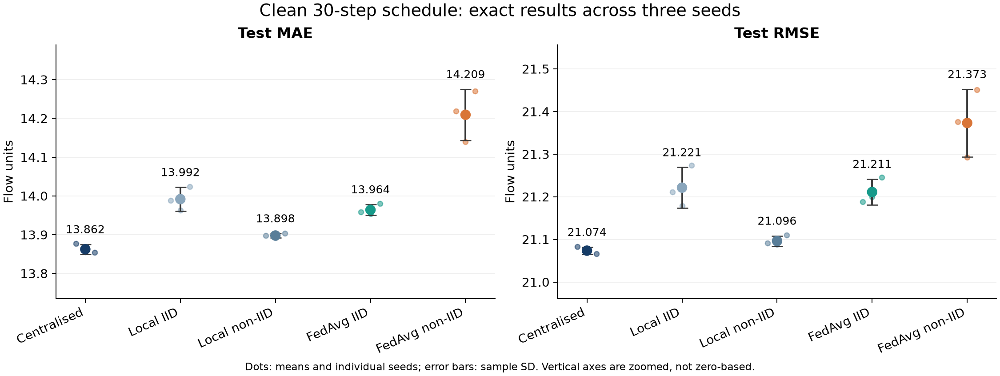
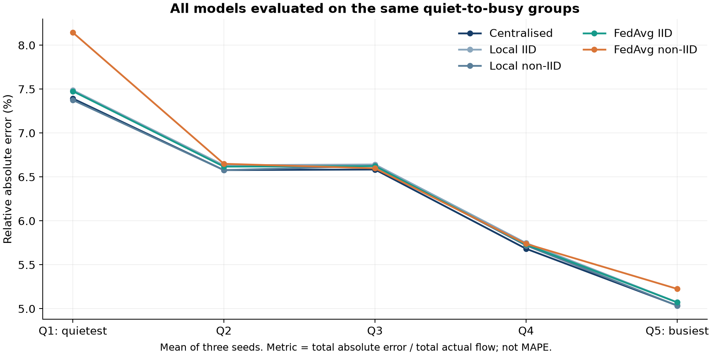
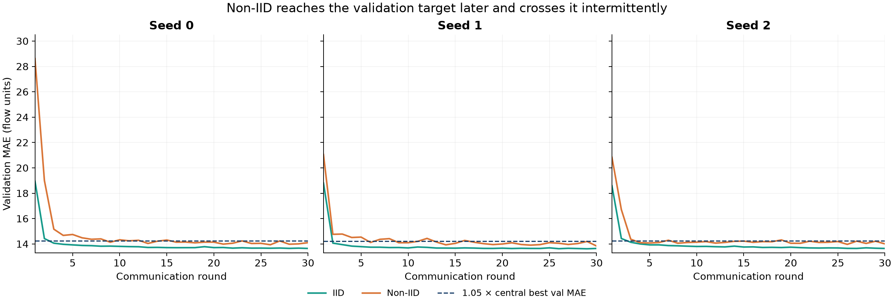

# Chauraha Sync — Independent PS-003 Final Matrix Audit

**Date:** 19 October 2026  
**Problem:** A3-PS003-TC520 — Federated Traffic-Flow Prediction with Communication-Cost Evaluation  
**Input:** `A3-PS003-TC520_v3.1_with_full_results.zip`  
**Verdict:** **PASS for the clean 30-round main matrix**, within the documented experimental scope. No mandatory full-matrix rerun is indicated. The previously planned 100-round diagnostic has not been run in this audit.

## Executive conclusion

The actual 15 JSON files are internally consistent, match the supplied full configuration and independently hashed dataset, and implement the corrected validation/test protocol. All **793 independent artifact checks** passed, with **zero failures**. The supplied 25-test suite also passed in this environment; both smoke and full result directories passed the supplied checker.

Centralised training has the lowest average test MAE among the five evaluated learned conditions. IID FedAvg is only **0.73% above** centralised MAE; non-IID FedAvg is **2.50% above**. All learned conditions beat persistence in both MAE and RMSE for every seed.

The important result is not “FedAvg wins.” Non-IID FedAvg reaches the validation accuracy target later, has larger observed seed variation, and exhibits a larger relative-error gap on the same quiet-to-busy evaluation groups. In particular, the quietest group is worse under non-IID FedAvg than matched local-only training in all three seeds. **H4 is contradicted by the experiment.** This negative result is a valid and useful evaluation finding; the model or hypothesis should not be changed to hide it.

## 1. What was independently verified

Every learned result was checked against the actual supplied configuration, not just against the other result files. Dataset SHA-256, training scaler, eligible train/validation/test counts, sensor membership, client sample counts and primary W1 values were independently reconstructed from the local copy of the same NPZ.

The audit also verified complete and unique epoch/round histories; each selected checkpoint's argmin index **and stored validation value**; all 30 local-client checkpoints; per-client gap arithmetic; and the identities linking pooled overall MAE, RMSE and relative error to the client summaries. RMSE was checked as the square root of the weighted mean of client squared RMSEs, not as an average of client RMSEs.

The scientific source files in the completed archive are byte-for-byte unchanged from the earlier reviewed v3.1. The reviewed code uses train-only preprocessing/partition decisions, no cross-boundary windows, validation-only model selection, and test scoring after that selection. No blocking leakage defect was found on this normal PEMS08 execution path. Tests and code inspection are evidence for this protocol, not an unconditional proof of all possible behavior.

### Representative neural reproduction

Without modifying any uploaded result, two full-data seed-0 runs were independently repeated using the supplied code and configuration. Outputs were saved separately under `reproduction/`.

| Independently repeated condition | Seed | MAE difference vs supplied JSON | RMSE difference | Same selected checkpoint | Largest validation-history difference |
| --- | --- | --- | --- | --- | --- |
| Centralised | 0 | -1.93e-11 | 2.11e-12 | Yes | 0 |
| FedAvg non-IID | 0 | 0 | 3.1e-11 | Yes | 0 |

This verifies two representative training outcomes, not an independent repetition of all 15 runs. No tuning or methodology change was performed. Other 13 runs received artifact and code-level verification.

### Verified dataset

```text
SHA-256: e1d03ce74e9fb79149e6e7c37c680214822c4a285baa2f42278cacabcd25c075
Full configuration hash: e01612b17a75ef4b938b7089ced20cb1048991b9e9e652bf235b026b1c333557
```

PEMS08 channel 0 is used as flow, at five-minute intervals, with 170 sensors and five simulated clients of 34 sensors. The primary task predicts the next five-minute flow from 12 preceding flows and two global index-based cycle features. PEMS08 is a California public benchmark, not Bengaluru data. The five groups are simulated clients, not verified physical intersections.

## 2. Data and baseline evidence

The complete-case protocol produces **2,098,136 training windows**, **448,263 validation windows**, and **448,533 test windows**. These replace the old PDF's unfiltered counts. Exact zeros are treated as missing markers for this study, an explicit modelling assumption rather than proof that every zero is missing. Approximately 1.16%, 1.09% and 1.07% of unfiltered windows are dropped in the respective splits.

| Baseline | Test MAE | Test RMSE | Test relative error | Test windows |
| --- | ---: | ---: | ---: | ---: |
| Persistence | 16.077531 | 24.450752 | 6.887958% | 448,533 |
| Per-sensor index-based daily cycle | 34.776327 | 51.077981 | 14.898923% | 448,533 |

Both were independently recomputed and matched the archived JSON. The daily-cycle table uses valid training values per sensor and global index slot, rather than pooling sensors. Its poorer performance than persistence is valid under this protocol; it is not evidence that phase misalignment persists.

**Correction to an earlier review:** I previously confused the daily-cycle validation MAE of 37.540282 with its test MAE of 34.776327. The archived file and Claude's stated test result were correct.

Primary heterogeneity W1 is measured between distributions of sensor training means. Random IID seeds yield **28.407035, 30.085115 and 30.792521**; deterministic quiet-to-busy bands yield **127.866742**. Pooled-value W1 is a different, supplementary statistic and must not be substituted.

## 3. Exact overall accuracy and comparisons

Values below are calculated from the full-precision JSON values using **sample SD (`ddof=1`) across three seeds**. Table display is rounded only after aggregation.

| Condition | Test MAE: mean ± sample SD | Test RMSE: mean ± sample SD | MAE reduction vs persistence | MAE increase vs centralised |
| --- | --- | --- | --- | --- |
| Centralised | 13.862 ± 0.013 | 21.074 ± 0.008 | 13.78% | 0.00% |
| Local IID | 13.992 ± 0.031 | 21.221 ± 0.048 | 12.97% | 0.93% |
| Local non-IID | 13.898 ± 0.005 | 21.096 ± 0.012 | 13.56% | 0.26% |
| FedAvg IID | 13.964 ± 0.014 | 21.211 ± 0.031 | 13.15% | 0.73% |
| FedAvg non-IID | 14.209 ± 0.066 | 21.373 ± 0.079 | 11.62% | 2.50% |

Baseline methods are deterministic and are not assigned a fabricated seed SD. Overall local-only metrics pool all test predictions; they are not equal-client averages. In this positive dataset, overall relative absolute error is a rescaling of overall MAE by the shared mean target flow, rather than independent evidence of a new accuracy outcome.



No condition is tuned to reproduce old PDF figures. The earlier headline “IID FedAvg beats centralised” is superseded. Differences here describe this architecture, dataset, split, partitions, optimiser protocol and training schedule. They do not establish universal superiority or statistical equivalence.

## 4. Client-level disparity: compare the same groups

The headline diagnostic is `sum(abs(error)) / sum(actual)` per client. This is a volume-normalized aggregate ratio, **not MAPE** and not a formal fairness guarantee. A difference between percentages is reported in **percentage points (pp)**.

For the training-arrangement comparison, all models must be evaluated on the same deterministic quiet-to-busy groups. That comparison is available in every JSON and avoids confusing changes in group membership with changes in model quality.

| Condition | Relative-error gap on SAME quiet-to-busy groups (pp) | Absolute MAE gap on SAME groups |
| --- | --- | --- |
| Centralised | 2.356 ± 0.026 | 11.157 ± 0.084 |
| Local IID | 2.415 ± 0.015 | 11.197 ± 0.015 |
| Local non-IID | 2.342 ± 0.030 | 11.165 ± 0.045 |
| FedAvg IID | 2.404 ± 0.040 | 11.205 ± 0.037 |
| FedAvg non-IID | 2.919 ± 0.062 | 11.112 ± 0.199 |

On common evaluation groups, non-IID FedAvg has a **2.919 pp** gap versus **2.404 pp** for IID FedAvg, approximately **21.40% larger**. The paired gap differences are positive in all three seeds. Its absolute MAE gap, however, is slightly smaller than IID FedAvg's. This illustrates why an absolute-MAE gap alone can obscure proportional errors on quieter groups.

### Native/random grouping reference

| Training arrangement | Gap on random IID evaluation groups (pp) | Gap on canonical quiet-to-busy groups (pp) |
| --- | --- | --- |
| Centralised | 1.108 ± 0.597 | 2.356 ± 0.026 |
| Local IID | 1.123 ± 0.617 | 2.415 ± 0.015 |
| Local non-IID | 1.120 ± 0.595 | 2.342 ± 0.030 |
| FedAvg IID | 1.114 ± 0.613 | 2.404 ± 0.040 |
| FedAvg non-IID | 1.127 ± 0.632 | 2.919 ± 0.062 |

The IID FedAvg gap is about **1.114 pp on its random groups**, but **2.404 pp on the canonical groups** for the same predictions. Thus comparing 2.919 pp against 1.114 pp as if the groups were identical would overstate the training effect. Call the random grouping gap a **random-partition reference**, not a formal statistical noise floor.

### Per-client outcomes on canonical groups

Q1 is the quietest band by training mean flow; Q5 is the busiest. Group membership stays fixed across seeds.

| Condition | Canonical group | Test MAE: mean ± SD | Test RMSE: mean ± SD | Relative error: mean ± SD (%) |
| --- | --- | --- | --- | --- |
| Centralised | Q1 | 7.247 ± 0.005 | 10.509 ± 0.009 | 7.393 ± 0.005 |
| Centralised | Q2 | 12.232 ± 0.033 | 19.031 ± 0.030 | 6.578 ± 0.018 |
| Centralised | Q3 | 15.076 ± 0.022 | 21.076 ± 0.034 | 6.585 ± 0.009 |
| Centralised | Q4 | 16.035 ± 0.016 | 23.852 ± 0.005 | 5.683 ± 0.006 |
| Centralised | Q5 | 18.404 ± 0.080 | 26.807 ± 0.061 | 5.037 ± 0.022 |
| Local IID | Q1 | 7.340 ± 0.026 | 10.628 ± 0.021 | 7.489 ± 0.026 |
| Local IID | Q2 | 12.334 ± 0.039 | 19.090 ± 0.046 | 6.633 ± 0.021 |
| Local IID | Q3 | 15.207 ± 0.022 | 21.253 ± 0.044 | 6.642 ± 0.009 |
| Local IID | Q4 | 16.218 ± 0.051 | 24.055 ± 0.073 | 5.748 ± 0.018 |
| Local IID | Q5 | 18.537 ± 0.041 | 26.976 ± 0.069 | 5.073 ± 0.011 |
| Local non-IID | Q1 | 7.230 ± 0.023 | 10.492 ± 0.050 | 7.376 ± 0.024 |
| Local non-IID | Q2 | 12.231 ± 0.029 | 18.932 ± 0.044 | 6.577 ± 0.016 |
| Local non-IID | Q3 | 15.170 ± 0.048 | 21.133 ± 0.067 | 6.626 ± 0.021 |
| Local non-IID | Q4 | 16.141 ± 0.054 | 23.949 ± 0.065 | 5.720 ± 0.019 |
| Local non-IID | Q5 | 18.395 ± 0.023 | 26.841 ± 0.043 | 5.034 ± 0.006 |
| FedAvg IID | Q1 | 7.328 ± 0.041 | 10.620 ± 0.040 | 7.476 ± 0.042 |
| FedAvg IID | Q2 | 12.306 ± 0.016 | 19.138 ± 0.027 | 6.618 ± 0.009 |
| FedAvg IID | Q3 | 15.165 ± 0.021 | 21.203 ± 0.036 | 6.624 ± 0.009 |
| FedAvg IID | Q4 | 16.167 ± 0.019 | 24.016 ± 0.040 | 5.730 ± 0.007 |
| FedAvg IID | Q5 | 18.533 ± 0.018 | 26.979 ± 0.037 | 5.072 ± 0.005 |
| FedAvg non-IID | Q1 | 7.983 ± 0.080 | 11.184 ± 0.085 | 8.145 ± 0.082 |
| FedAvg non-IID | Q2 | 12.366 ± 0.019 | 19.085 ± 0.029 | 6.650 ± 0.010 |
| FedAvg non-IID | Q3 | 15.108 ± 0.017 | 21.095 ± 0.025 | 6.599 ± 0.007 |
| FedAvg non-IID | Q4 | 16.193 ± 0.029 | 24.004 ± 0.035 | 5.739 ± 0.010 |
| FedAvg non-IID | Q5 | 19.095 ± 0.243 | 27.521 ± 0.275 | 5.226 ± 0.067 |



## 5. H4: quietest group's result

For Q1, matched local-only MAE is **7.229963**, compared with **7.983463** for non-IID FedAvg. FedAvg is **10.42% worse** in average MAE. The paired difference is **0.753500 ± 0.084245** flow units.

The corresponding relative errors are **7.375992%** versus **8.144711%**, a paired average increase of **0.768719 pp**. MAE, RMSE and relative error are worse for this group in every seed.

H4 predicted a benefit from shared training. It is **refuted for this setup**. Cross-client information sharing cannot be described as automatically beneficial. Possible explanations such as objective conflict, model capacity or optimiser behavior are hypotheses for future analysis, not mechanisms established by this experiment.

## 6. Validation convergence and communication-to-target

For each seed, the accuracy target is:

```text
target validation MAE = 1.05 × that seed's best centralised validation MAE
```

The first hit is computed from the saved validation history. Test metrics are not used to choose a round count. First hit does not necessarily imply convergence or lasting stability.

| Condition | Seed | Target validation MAE | First hit round | Bytes to first hit | First round remaining below through 30* | Best round |
| --- | --- | --- | --- | --- | --- | --- |
| FedAvg IID | 0 | 14.247689 | 3 | 61,560 | 3 | 30 |
| FedAvg IID | 1 | 14.223784 | 2 | 41,040 | 2 | 29 |
| FedAvg IID | 2 | 14.249224 | 3 | 61,560 | 3 | 30 |
| FedAvg non-IID | 0 | 14.247689 | 9 | 184,680 | 16 | 26 |
| FedAvg non-IID | 1 | 14.223784 | 6 | 123,120 | 17 | 30 |
| FedAvg non-IID | 2 | 14.249224 | 4 | 82,080 | 20 | 26 |

\* “First round remaining below through 30” is a retrospective descriptive calculation. It is not a pre-registered online early-stopping rule and does not certify behavior after round 30.

IID first-hit rounds are **3, 2, 3**; non-IID first-hit rounds are **9, 6, 4**. Their mean accounted payload costs to first hit are **54,720** versus **129,960 bytes**. Non-IID crosses back above the target after early hits in all three runs, whereas IID stays below after its first hit throughout the remaining observed rounds.



IID validation-best rounds are **30, 29, 30**; non-IID rounds are **26, 30, 26**. Several late minima justify the previously planned 100-round diagnostic. They do not invalidate the fixed 30-round matrix and do not establish that training fully converged. If a diagnostic is performed, preserve this main matrix and publish diagnostic results separately, with the same seeds and unchanged initialisation/shuffle schedule.

## 7. Communication arithmetic and correct claims

| Quantity | Accounted float32 bytes |
| --- | ---: |
| 513 model parameters | 2,052 |
| Download + upload, five clients, one round | 20,520 |
| Completed 30-round run | 615,600 |
| 100-round diagnostic, if completed | 2,052,000 |
| Training-flow reference: 12,499 × 170 × 4 | 8,499,320 |
| Full-stream flow reference, not primary | 12,142,080 |
| 414 federated rounds | 8,495,280 |
| 415 federated rounds | 8,515,800 |

The continuous crossing is **414.196881 rounds**: below the labelled reference through 414 and above it at 415. The 30-round total is **13.806563 times smaller**, or **92.757068% lower**, than the training-flow reference.

Safe wording: **“The 30-round run accounted for 615,600 uncompressed model-payload bytes, versus an 8,499,320-byte float32 training-flow upload reference.”**

Unsafe wording: “92.76% measured mobile-network bandwidth savings.” These are simulated payload counts, not actual traffic measured over a transport protocol. Headers, serialization, retries, coordination, validation metrics and security mechanisms are outside this counter. The model is trained in one process; the simulator is not an actual distributed deployment.

Zero bytes for centralised/local conditions mean **zero model-exchange bytes**, not zero raw-data upload cost or zero total system cost. The raw training-flow reference is a separate quantity.

A best checkpoint at round 26 costs 533,520 bytes through that round, but the completed 30-round run still spent 615,600 bytes. Retrospective checkpoint cost must not be substituted for total completed cost.

## 8. H1–H4 disposition

| Hypothesis | Disposition | Evidence and boundary |
| --- | --- | --- |
| H1: IID accuracy similar to centralised; non-IID larger client relative-error gap | Supported descriptively | IID MAE is +0.73%; common-group gap rises from 2.404 pp to 2.919 pp. “Similar” was not an equivalence margin or test. |
| H2: non-IID greater seed variability and slower convergence | Supported within observed 30 rounds | Test-MAE SD 0.065827 vs 0.013982; later target hits and later persistent-below-target behavior. No asymptotic convergence claim. |
| H3: MLP beats persistence | Supported for all tested conditions/seeds | Each of 15 runs beats persistence in both test MAE and RMSE. |
| H4: quietest client benefits over local-only | Refuted in this experiment | FedAvg worsens Q1 MAE, RMSE and relative error in all three seeds. |

Three seeds provide descriptive replication, not population-level inferential certainty. Overlapping windows from the same time series cannot be treated as hundreds of thousands of independent experiments. IID seeds vary partition membership as well as initialisation/batch ordering, while deterministic non-IID membership does not vary. Consequently the seed SDs measure different combinations of randomness and should not be explained solely as optimiser instability.

## 9. Suspicious items, limitations and rerun decision

### No mandatory full rerun identified

All independent consistency checks pass. Two representative neural reruns reproduce selected checkpoints and numerical results. The source-code and result evidence do not justify discarding the clean matrix or changing its methodology. Failed H4 is a research finding, not a bug.

### Provenance and checker improvements for final packaging

Every learned file has `code_commit = unavailable (not a git repository)`. The ZIP is now an identifiable source snapshot, with file hashes captured in `audit_summary.json`, but it does not prove a historical Git commit or that hypotheses were committed before training. Do not claim Git-tracked pre-registration of these supplied runs. Preserve the original run metadata; do not insert a later Git hash as if it were the original training commit.

The supplied checker only establishes hash consistency across files, not independently expected data/config hashes. It checks test counts rather than test-window identities and is weaker on complete local histories and stored argmin values. The independent audit explicitly checks these additional properties; original JSONs do not contain their own window-identity hash. Source review and data reconstruction support shared identities, not an exported prediction-level proof for all 15 runs.

Selected checkpoint arrays and test predictions were not originally saved. Preserve new source snapshots/dependency versions and selected checkpoint files for stronger reproducibility. The two independently repeated outputs in this package are audit copies, not replacements for the original matrix. No scientific rerun is required merely to reformat provenance.

### Experimental limits to state

The shared scaler is computed from all valid training values; this is a declared simulator preprocessing assumption, not a privacy-preserving distributed scaler. Exact-zero exclusion can bias representativeness; the quietest band's eligible sample count is lower. Sample-weighted FedAvg weights follow eligible windows, not equal sensor counts.

The optimizer is Adam with moments reset locally every federated round and persistent moments in centralised/local-only training. Thirty centralised epochs and thirty federated rounds of one local epoch are approximately matched sample passes, not identical optimizer trajectories or compute/parallel-time budgets. Summed client minibatch steps are approximately the centralised total, while each individual client has fewer sequential updates between aggregation points. State this rather than claiming a fivefold difference in total work.

The code's guards reject unsupported horizon/lags/client count, which is appropriate for this fixed must-have model. Some generic edge-case guards for empty clients/splits, zero variance or malformed inputs remain incomplete; the independently checked PEMS08 counts are nonempty and finite. Dependencies and BLAS/thread details should be recorded for final reproduction. A dashboard, GRU, longer horizon or new partition is not needed to make this study valid.

## 10. AIORI alignment and final safe narrative

The audited main matrix supplies the official PS-003 evidence: one public dataset; five simulated clients; one compact model; sample-weighted FedAvg; chronological splitting; IID/non-IID comparison; MAE/RMSE; accounted communication per round; convergence histories; and three seeds. Matched local-only references and common-group relative-error analysis are useful evaluation additions, not a new algorithm.

The final required prototype/pseudocode demonstration and updated PDF must reflect the audited clean results. Existing Level 1 numbers are superseded, including the previous validation-as-test values, pooled daily-cycle baseline and unfiltered window counts. Keep the original Level 1 artifact for historical transparency rather than rewriting its date or pretending the corrected results existed earlier.

**Recommended report abstract/result paragraph:**

> Under a complete-case PEMS08 protocol with five simulated clients and a compact 513-parameter MLP, centralised training achieved test MAE 13.862 ± 0.013, compared with 13.964 ± 0.014 for IID-style FedAvg and 14.209 ± 0.066 for quiet-to-busy non-IID FedAvg across three seeds. All learned conditions outperformed persistence. On the same quiet-to-busy evaluation groups, the relative-error gap increased from 2.404 to 2.919 percentage points for non-IID FedAvg. The quietest group did not benefit from federation compared with its matched local-only model, contradicting our pre-run prediction. IID FedAvg first reached within 5% of seed-matched centralised validation MAE in 2–3 rounds, versus 4–9 rounds for non-IID FedAvg. A completed 30-round run accounted for 615,600 model-payload bytes against an 8,499,320-byte training-flow reference. These findings describe one dataset, split, model and simulation protocol; they do not establish formal privacy, production network savings or generalisation to Bengaluru.

## Appendix A — All 15 full-precision run results (displayed to nine decimals)

| Condition | Seed | Test MAE | Test RMSE | Relative absolute error (%) |
| --- | --- | --- | --- | --- |
| Centralised | 0 | 13.877108369 | 21.082855823 | 5.945250 |
| Centralised | 1 | 13.855435682 | 21.071228776 | 5.935965 |
| Centralised | 2 | 13.854723880 | 21.066751087 | 5.935660 |
| Local IID | 0 | 13.988813214 | 21.211696996 | 5.993107 |
| Local IID | 1 | 13.962509888 | 21.179227770 | 5.981838 |
| Local IID | 2 | 14.023751685 | 21.273282972 | 6.008076 |
| Local non-IID | 0 | 13.897872399 | 21.090765683 | 5.954146 |
| Local non-IID | 1 | 13.892450396 | 21.087991916 | 5.951823 |
| Local non-IID | 2 | 13.903133538 | 21.110113303 | 5.956400 |
| FedAvg IID | 0 | 13.958208660 | 21.188053693 | 5.979995 |
| FedAvg IID | 1 | 13.953875611 | 21.199662837 | 5.978139 |
| FedAvg IID | 2 | 13.979966916 | 21.245775421 | 5.989317 |
| FedAvg non-IID | 0 | 14.218150408 | 21.375990054 | 6.091360 |
| FedAvg non-IID | 1 | 14.139467623 | 21.292591863 | 6.057651 |
| FedAvg non-IID | 2 | 14.270222251 | 21.450870385 | 6.113669 |

## Appendix B — All validation-selected checkpoint indices

The independent audit confirmed each entry against its complete history and stored validation MAE.

| Condition | Seed | Model | Selection axis | Selected index | Validation MAE |
| --- | --- | --- | --- | --- | --- |
| Centralised | 0 | global | epoch | 29 | 13.569227 |
| Centralised | 1 | global | epoch | 28 | 13.546461 |
| Centralised | 2 | global | epoch | 22 | 13.570689 |
| Local IID | 0 | client 0 | epoch | 22 | 13.201897 |
| Local IID | 0 | client 1 | epoch | 29 | 14.134398 |
| Local IID | 0 | client 2 | epoch | 26 | 13.283349 |
| Local IID | 0 | client 3 | epoch | 28 | 13.836865 |
| Local IID | 0 | client 4 | epoch | 29 | 13.999634 |
| Local IID | 1 | client 0 | epoch | 29 | 14.355280 |
| Local IID | 1 | client 1 | epoch | 28 | 14.469334 |
| Local IID | 1 | client 2 | epoch | 29 | 11.909362 |
| Local IID | 1 | client 3 | epoch | 30 | 13.393792 |
| Local IID | 1 | client 4 | epoch | 29 | 14.128044 |
| Local IID | 2 | client 0 | epoch | 30 | 13.641796 |
| Local IID | 2 | client 1 | epoch | 29 | 14.144857 |
| Local IID | 2 | client 2 | epoch | 30 | 13.787317 |
| Local IID | 2 | client 3 | epoch | 30 | 13.947797 |
| Local IID | 2 | client 4 | epoch | 30 | 12.965672 |
| Local non-IID | 0 | client 0 | epoch | 26 | 7.323305 |
| Local non-IID | 0 | client 1 | epoch | 24 | 12.329795 |
| Local non-IID | 0 | client 2 | epoch | 27 | 14.897659 |
| Local non-IID | 0 | client 3 | epoch | 29 | 15.634912 |
| Local non-IID | 0 | client 4 | epoch | 30 | 17.728785 |
| Local non-IID | 1 | client 0 | epoch | 22 | 7.313055 |
| Local non-IID | 1 | client 1 | epoch | 28 | 12.310684 |
| Local non-IID | 1 | client 2 | epoch | 30 | 14.760911 |
| Local non-IID | 1 | client 3 | epoch | 22 | 15.694345 |
| Local non-IID | 1 | client 4 | epoch | 25 | 17.743801 |
| Local non-IID | 2 | client 0 | epoch | 29 | 7.302595 |
| Local non-IID | 2 | client 1 | epoch | 27 | 12.319561 |
| Local non-IID | 2 | client 2 | epoch | 21 | 14.811990 |
| Local non-IID | 2 | client 3 | epoch | 30 | 15.715219 |
| Local non-IID | 2 | client 4 | epoch | 30 | 17.765137 |
| FedAvg IID | 0 | global | round | 30 | 13.646794 |
| FedAvg IID | 1 | global | round | 29 | 13.619484 |
| FedAvg IID | 2 | global | round | 30 | 13.645933 |
| FedAvg non-IID | 0 | global | round | 26 | 13.936660 |
| FedAvg non-IID | 1 | global | round | 30 | 13.838957 |
| FedAvg non-IID | 2 | global | round | 26 | 13.968431 |

## Appendix C — Files and reproduction

`audit_summary.json` contains exact aggregates, contrasts, reconstructed partition memberships, first-hit round analysis and source/file SHA-256 manifest. `verification_checks.json` contains all 793 check labels. `per_run_metrics.csv`, `per_client_metrics.csv` and `convergence_by_round.csv` preserve the numeric evidence behind the tables and figures. `reproduction/reproduction_report.json` documents the scope and numerical differences of the two neural repetitions.

`audit_results.py` regenerates the artifact checks and analysis from the supplied raw ZIP contents and verified NPZ. Example:

```bash
OPENBLAS_NUM_THREADS=1 OMP_NUM_THREADS=1 python3 audit_results.py \
  --root /path/to/A3-PS003-TC520 \
  --data /path/to/PEMS08.npz \
  --out /path/to/audit-output
```

These audit outputs do not include the raw dataset or credentials, and no GitHub push or presentation generation was performed.
